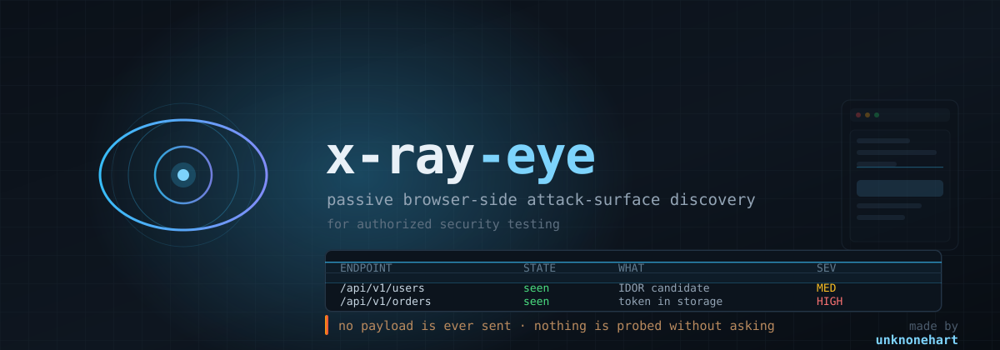

<p align="center">
  
</p>

<p align="center">
  <b>Passive browser-side attack-surface discovery for authorized security testing.</b>
</p>

<p align="center">
  made by <a href="https://www.instagram.com/un1kn0n3_h4rt/"><b>unknonehart</b></a>
  &nbsp;·&nbsp;
  <a href="https://www.instagram.com/un1kn0n3_h4rt/">@un1kn0n3_h4rt</a>
</p>

---

## What is in here

There are **two tools**, and they share one engine.

| | what it is | where it runs | how you use it |
|---|---|---|---|
| **`../dark-eye-api.js`** | the original scanner | inside the page | paste into DevTools |
| **`xray-eye-extension/`** | the same scanner, plus a full side panel and the Bug Bounty Security Analyzer | in Chrome | load it as an unpacked extension |

The extension is **not a rewrite**. `src/engine.js` started as a copy of `../dark-eye-api.js`, and every classifier, every verdict and every rule in it is the original, unmodified. The extension adds a user interface around it, sixteen new public methods, and a second analyser that reads the engine's own stores.

Both files have had their comments removed, so the two read the same way. The code is unchanged: the original still exposes the same **59** public members, and the extension adds **16** without removing one.

**Nothing is sent to anyone.** The scanner reads what the page already did. The two actions that do send traffic — `read all` and `probe` — are separate, labelled, and ask first.

---

## Install the extension

**Requirements:** Chrome 116 or newer (the `sidePanel` API). No build step, no dependencies, no `npm install`.

1. **Get the files.** Clone or copy the `xray-eye-extension` folder somewhere permanent. Chrome loads the folder, not a build, so moving it later breaks the install.

2. **Load it.**
   - open `chrome://extensions`
   - turn on **Developer mode** (top right)
   - click **Load unpacked**
   - select the `xray-eye-extension` folder

3. **Open the panel.** Click the toolbar button, or press **Ctrl+Shift+E**.

4. **Press Start.** The scanner is injected on demand, not on every page. Until you press it, the panel says *"Not capturing"* — that is the idle state, not an error.

5. **Grant the cookies permission** when Chrome asks. It is needed for the **Cookies** tab. If you skip it, every other tab still works and the Cookies tab says so plainly.

6. **Browse the application.** Findings appear as the page makes requests. Reload the page after pressing Start if the app loaded before you did.

### After changing the files

Chrome caches the service worker. A plain **Reload** is not always enough:

1. `chrome://extensions` → **Reload**
2. click the blue **service worker** link → **Stop**
3. **Reload** again
4. close and reopen the side panel

Bumping `version` in `manifest.json` also forces Chrome to re-fetch the worker.

---

## Install the original scanner

No install. Open the target page, press **F12**, and paste the whole of `../dark-eye-api.js` into the console.

It prints a short guide and then waits. The commands you will want first:

```js
xrayeye.exposed()        // everything exposed right now, worst first
xrayeye.findings()       // every endpoint found, so you can copy a real URL
xrayeye.triageReport()    // real credentials, test fixtures and arbitrary strings, separately
xrayeye.security()       // full triage across every surface
xrayeye.help()           // the full command list
```

It attaches to the page's own `fetch` and `XMLHttpRequest`, so it only sees traffic the application makes after you paste it.

---

## What the extension adds

### The Bug Bounty Security Analyzer

A second analyser, spliced into the engine, that reads the engine's own stores — response headers, bodies, tokens, notes — and reports findings grouped by class, with a **basis** on every row:

| basis | what it means |
|---|---|
| `OBSERVED` | read out of something the application actually produced |
| `CANDIDATE` | a reflection the analyser saw; one request would settle it |
| `HYPOTHESIS` | needs two accounts of different privilege to settle it |

That distinction is the point of the tab. A panel that blurs "I read this" and "I think this might be" is worse than no panel.

| group | what it covers |
|---|---|
| **Headers & cookies** | `Secure` / `HttpOnly` / `SameSite` on every cookie, CSP, HSTS, `X-Frame-Options`, `Referrer-Policy`, `Permissions-Policy`, `Cross-Origin-Opener-Policy`, wildcard CORS, exact server versions |
| **Config leaks & verbose errors** | stack traces, `phpinfo`, `.git/config`, config dumps, private keys, provider keys, PII shapes, CMS versions |
| **Injection candidates** | reflected XSS, error-based SQLi, SSTI, SSRF, command injection, NoSQL operator keys, XXE, JSONP, open redirect, markup injection |
| **Function-level authz** | privileged routes with no auth signal, GraphQL introspection, **CSRF** (a privilege field with no token, and a form that posts with no token at all) |
| **Session security** | tokens in web storage, long-lived tokens, recoverable weak HMAC secrets, `alg:none`, logout that lies, cookie scope |
| **Potential points** | entry points the app actually used, matched against nine categories — IDOR, SSRF, file, redirect, auth, business logic, mass assignment, query shaping, untrusted output — each with a confidence and a **review status you control** |
| **Technology & version** | the server stack the headers disclosed, and the versions **known to be broken** |
| **Client-side data flow** | a source reaching a raw-HTML sink, with the chain shown |

### The other tabs

| tab | what it shows |
|---|---|
| **Overview** | counts by channel, what was inspected against what was found |
| **Endpoints** | every request, filterable by observed, third-party, IDOR candidate, no-auth, challenge |
| **Credentials** | hardcoded values with their verdict and the reason for it |
| **JWT** | tokens, their claims, their weak secrets, their lifetimes |
| **Storage** | `localStorage` / `sessionStorage` / `IndexedDB` / `Cache` |
| **Auth flows** | OAuth redirects, and hardcoded login pairs with the check that accepts them |
| **Cookies** | read and write this site's cookies — see below |
| **Exposure** | private addresses, internal hostnames, CMS versions, source maps |
| **Subdomains** | the certificate-transparency log for the registered domain |
| **Stack** | the server stack, known-bad versions, client libraries, build tools, hosting, service workers, server actions |
| **Specs** | parsed OpenAPI / GraphQL / Postman documents |
| **Notes** | every note, filterable by kind |
| **Export** | markdown, JSON, endpoint CSV, secrets CSV — downloadable |
| **Settings** | auto-start, host allowlist, diagnostics |

### Cookies

Read and write this browser's cookies for the site on the current tab.

- **Export** — as a `Cookie:` header, as JSON, or in the Netscape format curl and Burp read. All three filenames carry the host and a timestamp.
- **Import** — paste a header, a JSON array, or a Netscape file. A cookie for a domain that does not cover the host is **refused**, not quietly applied somewhere it does nothing.
- **Clear** — sign out of the site in this browser.

The export is a live session. It is a credential, and it should be treated like one.

### Subdomains

Reads the public certificate-transparency log for the **registered domain** of the current page.

Certificate transparency is indexed by registered domain, so the host is reduced to its eTLD+1 first: `csi-india.org` stays, `ess.cehrd.gov.np` becomes `cehrd.gov.np`, because `gov.np` is a public suffix and `cehrd.gov.np` is the registrable domain. Getting that wrong does not fail loudly — it searches somebody else's namespace.

The log returns names, not hosts. **Check which are alive** sends a plain `GET` for the root of each name and shows the status, the time and where a redirect went. It is the only part of the tool that talks to hosts it was not asked to talk to, so it is a button and not something that happens on its own.

### Third-party code

A page can load code from another origin — a chat widget, an analytics tag, a payment form — and the browser will not let a page read it. The **Analyse third-party code** button has the service worker fetch that code and read it, and reports a DOM-XSS shape it finds: a value written into a raw-HTML sink behind a check for markup. A filter that tests for markup is a filter that *passes* markup.

---

## Feature comparison

| | `../dark-eye-api.js` | extension |
|---|---|---|
| Endpoints, requests, response bodies | ✅ | ✅ |
| Credentials, with a verdict and a reason | ✅ | ✅ |
| JWT decode, weak secrets, `alg:none` | ✅ | ✅ |
| Storage, IndexedDB, Cache Storage | ✅ | ✅ |
| OAuth flows, hardcoded login pairs | ✅ | ✅ |
| Exposure, directories, sensitive paths | ✅ | ✅ |
| Specs, frameworks, server actions, service workers | ✅ | ✅ |
| Notes, marks, diffs, coverage | ✅ | ✅ |
| Reports: markdown, JSON, CSV, secrets CSV | ✅ | ✅ |
| `probe()` / `readAll()` — **active** | ✅ | ✅ (labelled, confirmed) |
| Sortable, filterable **table** | ❌ console only | ✅ 16 tabs |
| Export to a **file** | ✅ | ✅ |
| **Bug Bounty Security Analyzer** | ❌ | ✅ 11 groups, with a basis per row |
| **Known-vulnerable version matching** | ❌ | ✅ 24 advisories across 16 products |
| **Potential points** with confidence + review status | ❌ | ✅ |
| **Client-side data flow** (source → sink) | ❌ | ✅ |
| **Cookie import / export** | ❌ | ✅ 3 formats |
| **Subdomain discovery** from the CT log | ❌ | ✅ |
| **Third-party code analysis** | ❌ | ✅ on demand |
| **Host liveness** (status per subdomain) | ❌ | ✅ on demand |
| **Diagnostics** ("why is this empty?") | ✅ | ✅ |

---

## What is working, and what is not

Being straight about this, because a tool that overstates its coverage is worse than one that does not.

### Working

- Everything in the original scanner, unchanged, in both forms.
- The analyser groups, the basis labels, and the potential-points queue.
- Version matching against a bundled advisory snapshot.
- Cookie import and export in three formats.
- Subdomain discovery from the CT log, with the registered-domain reduction.
- Third-party code analysis, on demand.
- The diagnostics panel.

### Known gaps

| gap | why |
|---|---|
| **No test suite ships with the extension** | the development tooling was removed at the operator's request. The extension is verified by hand, not by `npm test` |
| **Cross-origin iframes are not read** | the browser will not hand over a cross-origin document. The third-party button fetches the code instead, but only when you press it |
| **Requests inside Web Workers are not captured** | they have their own `fetch`, out of the page's reach |
| **Stored XSS is not detected** | it needs correlation across sessions — a value written now and rendered later — and nothing here keeps that history |
| **SSRF is a candidate, never a confirmation** | proving it means making the server fetch a URL you control, which is an active request. The tool names the parameter and stops there |
| **DOM XSS in a third-party bundle is found on demand only** | the bundles are fetched when you ask, not as the page loads |
| **"does not resolve" vs "no response" cannot be told apart on stable Chrome** | `chrome.dns` is dev-channel only, so the liveness check reports a failure without saying which kind |
| **A request the page's own CSP blocked is marked `failed`, not traffic** | it never left the browser, and presenting it as captured traffic would be a lie |

### Blind spots, from the original

- Cross-origin iframes — use `xrayeye.iframeSnippet()` for a same-site frame.
- Web Worker traffic.

---

## The actions that send traffic

Everything else is passive. These are not, and the panel labels them.

| action | what it sends |
|---|---|
| **read all** | a `GET` for every route the scanner found. Your target's logs will show it. |
| **probe** | a `GET` for a list of paths the scanner guessed. `confirm:'AUTHORIZED'` is required. |
| **Check which are alive** | a `GET` for the root of every subdomain name in the list. |
| **Analyse third-party code** | a `GET` for the third-party code and the scripts it loads. |
| **Authorize active reads** | lets the page read values that are normally withheld. |

---

## Layout

```
banner.svg                the header image at the top of this file
manifest.json             MV3 manifest: side panel, content scripts, service worker
src/
  quiet.js                MAIN, first. Silences the console for the engine's boot only.
  engine.js               MAIN. The scanner, plus the security analyser.
  page.js                 MAIN. Turns window.xrayeye into request/response
  content.js              ISOLATED. The only bridge between the two worlds
  background.js           Service worker: panel, badge, downloads, header capture
panel/
  panel.html              Markup
  panel.css              Styling
  panel.js                Rendering, filtering, exports, row actions
  subdomain.js            Certificate-transparency subdomain discovery
  cookies.js              Cookie import and export
icons/                    Generated PNGs
```

### How the worlds connect

The scanner must run in the **page's world** — it hooks `window.fetch`, reads window globals and inspects the real DOM. The panel is an extension page and cannot touch that world. So:

```
panel  ──chrome.tabs.sendMessage──▶  content.js (ISOLATED)
                                          │  CustomEvent + JSON on window
                                          ▼
                                      page.js (MAIN)  ──▶  window.xrayeye
```

`src/content.js` answers only from the **top frame**. Sub-frames still run the scanner so iframe traffic is captured, but mixing per-frame stores would blend unrelated origins into one list.

---

## Permissions, and why

| permission | why |
|---|---|
| `sidePanel` | the panel itself |
| `tabs` | knowing which tab the panel is looking at |
| `scripting` | injecting the scanner and registering it for auto-start |
| `webRequest` | reading `Set-Cookie`, which Chrome hides from page JavaScript entirely. Without it, every cookie-flag check is structurally impossible |
| `cookies` | the Cookies tab |
| `storage` | your settings and your review status |
| `downloads` | saving reports |
| `http://*/*`, `https://*/*`, `file:///*` | the scanner has to run on the pages you test |

---

## Scope and limits

- **Passive by default.** `probe()` is the only active path in the original, and it is refused unless you explicitly confirm authorization. `read all` is separate and separately confirmed.
- **Values show in cleartext.** There is a "mask values" switch, and it is off. What you capture is yours; decide what to share.
- **Chrome blocks extensions** on `chrome://`, the Web Store and other extensions' pages. The panel says so rather than appearing broken.
- **Use only against systems you are authorized to test.**

---

<p align="center">
  <sub>Made for the people who read the source before running it.</sub>
</p>

---

## Credits

Built by **[unknonehart](https://www.instagram.com/un1kn0n3_h4rt/)** — [@un1kn0n3_h4rt](https://www.instagram.com/un1kn0n3_h4rt/)

The scanner reads what the application already did. It sends no payload, contacts no third party, and writes nothing outside your own browser. Use it only against systems you are authorized to test.
